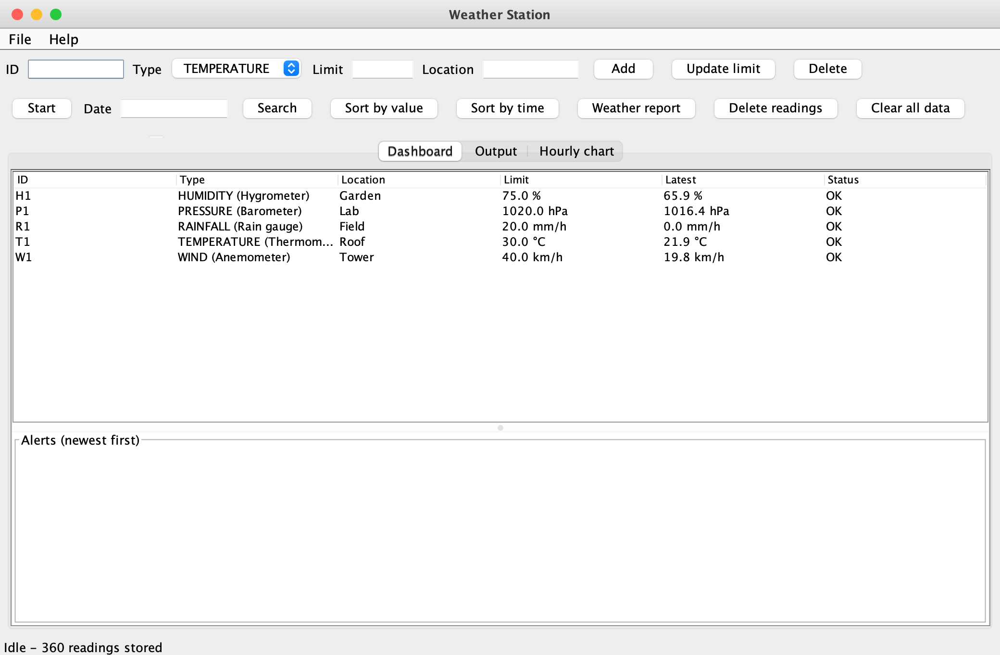
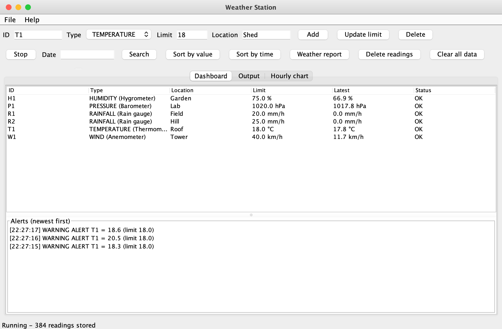
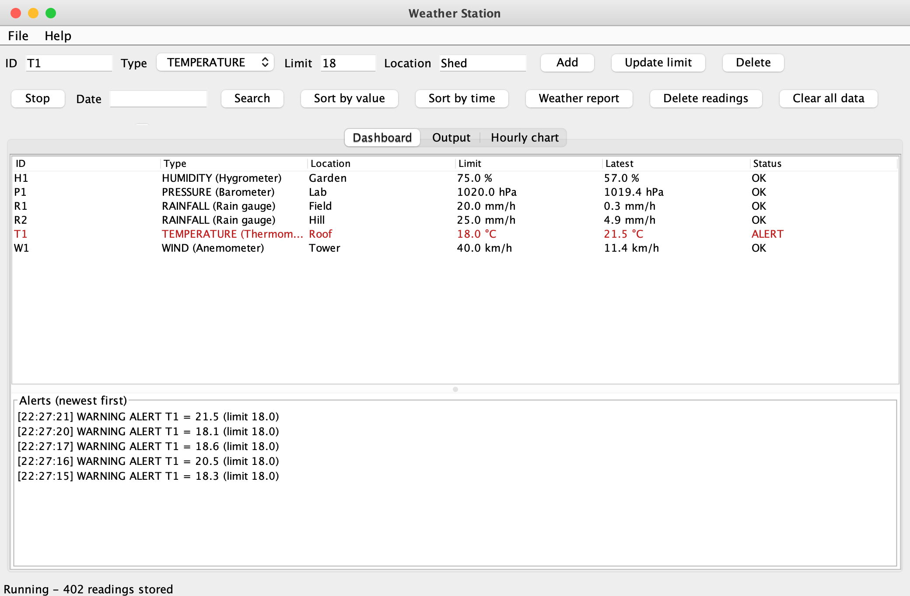
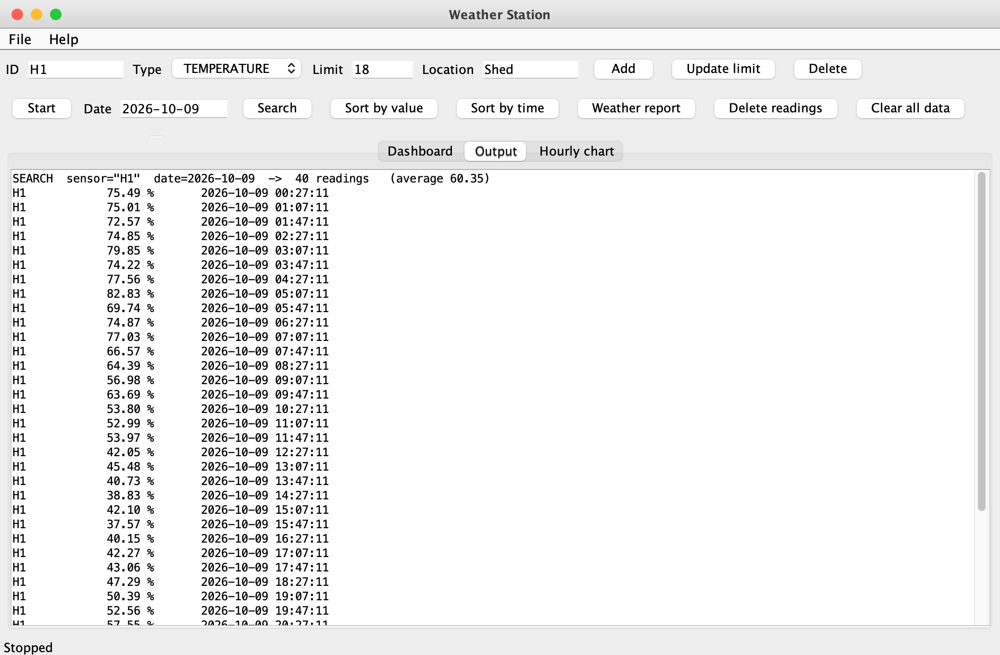
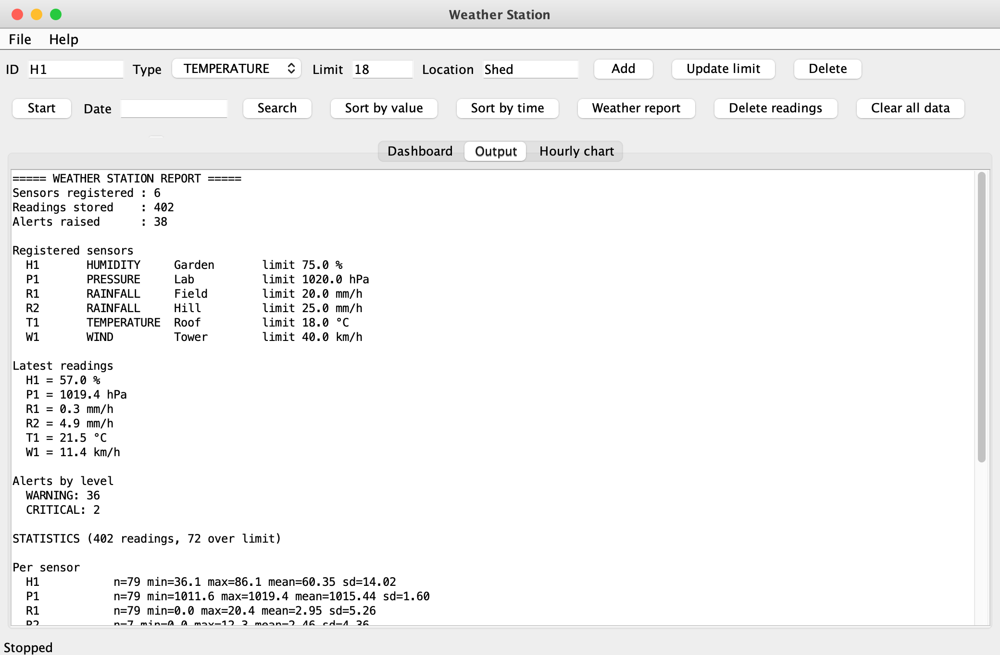
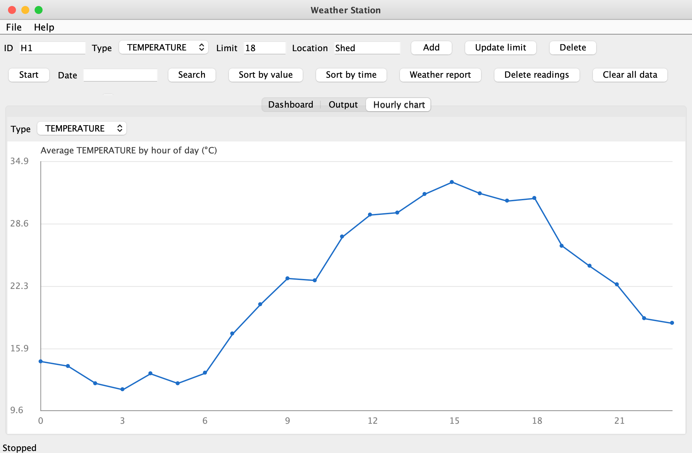
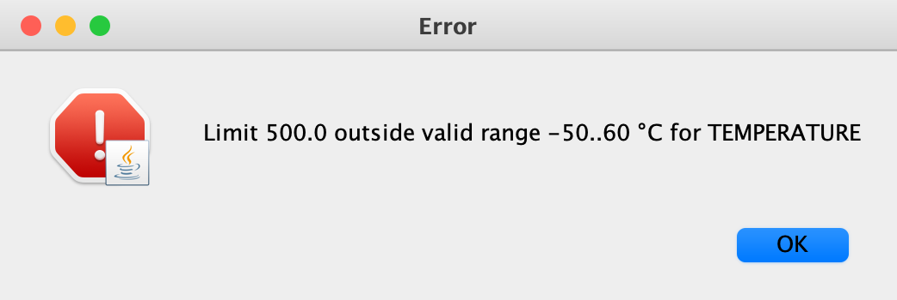

# Weather Station Data Logging & Alert System

A multi-sensor weather monitoring application written in **Java** with a **Swing** GUI. Several simulated sensors
(temperature, humidity, rainfall, pressure, wind) log readings continuously on background threads, the system
raises an alert whenever a reading crosses its threshold, and the operator can search, sort and report on the
stored data.

> Java Programming Case Study 99 &mdash; B.Tech CSE (2025-29), Semester III.
> Pure standard library: **no external dependencies, no build tool required.**



---

## Table of contents

1. [Features](#features)
2. [Screenshots](#screenshots)
3. [Quick start](#quick-start)
4. [Using the application](#using-the-application)
5. [Architecture](#architecture)
6. [Concurrency model](#concurrency-model)
7. [Validation and error handling](#validation-and-error-handling)
8. [Data structures](#data-structures)
9. [Java concepts demonstrated](#java-concepts-demonstrated)
10. [Testing](#testing)
11. [Project structure](#project-structure)
12. [Roadmap](#roadmap)
13. [Author](#author)

---

## Features

| Module | What it does |
|---|---|
| **Sensor registration** | Create, update and delete sensors, each with an id, a type, a location and an alert limit. |
| **Continuous data logging** | A producer thread samples every sensor each tick; a consumer thread stores the readings. Start/stop and a 100&ndash;3000 ms interval slider. |
| **Threshold alerting** | Every reading is checked against its sensor's limit. Alerts have a severity (`WARNING` / `CRITICAL`) and are kept in a newest-first history. |
| **Reading history** | Readings are kept per sensor (bounded ring buffer) and globally sorted by timestamp. |
| **Sensor search** | Search by sensor id, by calendar date, or both. Shows the match count and the average value. |
| **Data sorting** | Sort all readings by value or by timestamp (hand-written stable merge sort). |
| **Weather reports** | One combined report: sensors, latest values, alerts by level, per-sensor and per-type statistics, top readings. Plus an hour-of-day average chart. |

Also included: CSV export, sensor save/load, a headless demo mode and a self-contained test suite.

## Screenshots

| Live logging with alerts | Threshold alert history |
|---|---|
|  |  |

| Search by sensor and date | Weather report |
|---|---|
|  |  |

| Hourly chart | Validation error |
|---|---|
|  |  |

All 19 screenshots are in [`screenshots/`](screenshots). They are produced by `weather.tools.ScreenshotTool`,
which drives the real GUI (typing, clicking, waiting for the logging threads) and paints each state to a PNG:

```bash
java -cp out weather.tools.ScreenshotTool screenshots
```

## Quick start

**Requirements:** a JDK. Developed and tested on Java 26; the code uses language features available since Java 17
(records, sealed classes, switch expressions, text blocks).

```bash
git clone https://github.com/saiyash07/WeatherStationDataLoggingAlertSystemJAVA.git
cd WeatherStationDataLoggingAlertSystemJAVA

./run.sh gui        # compile and open the Swing application
./run.sh demo 5     # headless: simulate for 5 seconds and print a report
./run.sh test       # compile and run the 42 self-tests
```

Or build manually:

```bash
javac -d out $(find src -name '*.java')
java -cp out weather.Main            # GUI
java -cp out weather.Main --demo 5   # headless demo
java -cp out weather.Tests           # tests
```

## Using the application

1. Press **Start** to begin continuous logging; the table, alert list and status bar update live.
2. **Add** a sensor with the form (ID, Type, Limit, Location). Leave *Limit* empty to use the type's default.
3. Select a row and press **Update limit** to change its threshold &mdash; lower it to provoke alerts.
4. Use the **ID** and **Date** (`yyyy-MM-dd`) fields with **Search**.
5. Try **Sort by value**, **Sort by time** and **Weather report**; open the **Hourly chart** tab.
6. **Delete readings** removes one sensor's history; **Delete** removes the sensor itself.
7. *File* menu: save/load sensors, export readings to CSV.

### Sensor types

| Type | Unit | Valid range | Default limit | Simulation model |
|---|---|---|---|---|
| `TEMPERATURE` | °C | -50 to 60 | 40 | Daily sine wave plus noise |
| `HUMIDITY` | % | 0 to 100 | 80 | Inverse of temperature plus noise |
| `RAINFALL` | mm/h | 0 to 100 | 20 | Mostly dry; exponential intensity when raining |
| `PRESSURE` | hPa | 900 to 1100 | 1050 | Random walk around 1013 hPa |
| `WIND` | km/h | 0 to 200 | 90 | Absolute Gaussian with occasional gusts |

### Alert severity

`ratio = (value - limit) / max(|limit|, 1)`

| Condition | Level |
|---|---|
| `value <= limit` | no alert |
| `0 < ratio <= 0.25` | `WARNING` |
| `ratio > 0.25` | `CRITICAL` |

## Architecture

```
┌──────────────────────────────────────────────────────────────┐
│ weather.ui        MainFrame · SensorTableModel · Chart panel │  Swing, Event Dispatch Thread
├──────────────────────────────────────────────────────────────┤
│ weather.service   WeatherStation · Simulator · AlertPolicy   │  state, threads, rules
│                   StatisticsService · PersistenceService     │
├──────────────────────────────────────────────────────────────┤
│ weather.model     Sensor (+5 types) · Reading · Alert · enums│  validated domain objects
│ weather.util      Repository · BoundedHistory · Algorithms   │
│ weather.exception WeatherException hierarchy                 │
└──────────────────────────────────────────────────────────────┘
```

Dependencies point downwards only. The service layer notifies the GUI through the **Observer** pattern
(`WeatherListener`) and never references Swing.

| Pattern | Where |
|---|---|
| Observer | `WeatherListener` &mdash; the station pushes readings/alerts to the GUI |
| Strategy + Decorator | `AlertPolicy`, with `atLeast(level)` and `orElse(other)` |
| Factory | `SensorFactory` builds the right `Sensor` subclass |
| Template method | `Sensor.sample()` calls the subclass hook `simulate()` |
| Repository | `Repository` / `InMemoryRepository` |
| MVC | `SensorTableModel` + `MainFrame` over `WeatherStation` |

## Concurrency model

```
 PRODUCER thread                BlockingQueue               CONSUMER thread
 ScheduledExecutorService  ──►  ArrayBlockingQueue(2000) ──► Runnable on a daemon Thread
 one reading per sensor/tick    back-pressure buffer         WeatherStation.record(r)
                                                                   │
                                          listeners notified outside the lock
                                                                   ▼
                                          SwingUtilities.invokeLater (coalesced refresh)
```

* Start/stop is idempotent (`AtomicBoolean.compareAndSet`); the interval can be changed while running.
* An exception inside a scheduled task would silently cancel it, so each tick is wrapped in `try/catch (Throwable)`.
* One misbehaving listener cannot kill the consumer thread.
* `InterruptedException` restores the interrupt flag; shutdown uses a *poison pill* and `join`.
* Shared state: `ConcurrentHashMap` for lookups, one `ReentrantReadWriteLock` for the `TreeMap`, alert list and
  hourly arrays, `CopyOnWriteArrayList` for listeners, `volatile` for the editable sensor limit.
* A stress test records 4,000 readings from eight threads simultaneously and asserts none are lost.

## Validation and error handling

| Input | Rule | Exception |
|---|---|---|
| Sensor id | not blank, at most 12 chars, only letters / digits / `-` / `_` | `InvalidSensorException` |
| Sensor id | unique (atomic `putIfAbsent`) | `DuplicateSensorException` |
| Alert limit | numeric and inside the sensor type's range | `InvalidSensorException` |
| Reading value | finite and inside the type's range | `IllegalArgumentException` |
| Reading timestamp | not in the future (60 s clock skew allowed) | `IllegalArgumentException` |
| Search date | ISO `yyyy-MM-dd` | error dialog |
| Missing sensor | update/delete of an unknown id | `SensorNotFoundException` |
| Files | unreadable/unwritable; bad CSV lines are skipped and counted | `StorageException` |

```
Exception
 ├── WeatherException                (checked)
 │    ├── InvalidSensorException
 │    ├── DuplicateSensorException
 │    └── SensorNotFoundException
 └── RuntimeException
      └── StorageException           (wraps IOException)
```

Saved sensor files are read with an `ObjectInputFilter` whitelist, so a crafted file cannot instantiate
arbitrary classes.

## Data structures

| Structure | Used for | Why |
|---|---|---|
| `ArrayList` | query results, per-timestamp buckets | fast iteration |
| `LinkedList` | alert history (as a deque) | O(1) `addFirst` / `removeLast` for a capped newest-first list |
| `HashMap` (`ConcurrentHashMap`) | sensor id → latest reading | O(1) lookup, safe across threads |
| `TreeMap` | readings sorted by timestamp | `subMap` range queries, `pollFirstEntry` eviction |
| `double[24]` / `int[24]` | hourly snapshots | fixed size; index = hour of day |
| `EnumMap` | per-type arrays and alert counts | array-backed, fastest for enum keys |
| ring buffer (`BoundedHistory`) | last 500 readings per sensor | O(1) insert, memory never grows |
| `ArrayBlockingQueue` | producer → consumer hand-off | bounded and blocking |

Memory is bounded: 500 readings per sensor, 20,000 readings in total (oldest evicted), 200 alerts.

## Java concepts demonstrated

Classes and objects, constructors, abstraction, encapsulation, inheritance, polymorphism, interfaces (abstract,
`default`, `static`), sealed classes, records, enums with behaviour, generics (bounded types, wildcards, generic
methods), inner / anonymous / local classes, lambdas and method references, streams and `Optional`, wrapper
classes (autoboxing, a nullable `Double` average), arrays and the Collections framework, hand-written merge sort
and binary search, checked and unchecked exceptions, try-with-resources, `Thread` / `Runnable`, executors,
blocking queues, locks, atomics, `CompletableFuture`, file I/O and serialization, `java.time`, and Swing
(custom `TableModel`, custom painting, EDT discipline).

## Testing

A dependency-free runner (`weather.Tests`) executes **42 tests** and exits non-zero on any failure.

* Model validation (ids, limits, reading range, future timestamps, `equals`/`hashCode` across subclasses)
* Every sensor type stays inside its legal range
* Merge-sort stability, binary search, ring buffer, generic repository, validators
* Station behaviour: latest values, search by sensor/date, sort by value/time, alerts and severity, hourly
  averages, same-timestamp readings, range queries, delete, bounded memory, observers, alert-policy decorator
* Concurrency: full simulator pipeline, idempotent start/stop, eight-thread stress test
* Persistence: serialization round trip, CSV round trip with bad lines, missing-file errors

```bash
./run.sh test
# ...
# 42 passed, 0 failed
```

## Project structure

```
.
├── run.sh                      build + run helper (gui | demo | test)
├── screenshots/                GUI screenshots used in this README
└── src/weather/
    ├── Main.java               entry point (GUI, or --demo for headless)
    ├── Tests.java              42 self-tests
    ├── model/                  Sensor + 5 subclasses, Reading, Alert, SensorType, AlertLevel, Measurable
    ├── exception/              WeatherException hierarchy, StorageException
    ├── util/                   Repository, InMemoryRepository, BoundedHistory, Algorithms, Statistics, Validator
    ├── service/                WeatherStation, Simulator, AlertPolicy, SensorFactory,
    │                           StatisticsService, PersistenceService, WeatherListener
    ├── ui/                     MainFrame, SensorTableModel, HourlyChartPanel
    └── tools/                  ScreenshotTool (development aid)
```

## Roadmap

* Connect real hardware by adding a producer that calls `WeatherStation.record()`
* Database persistence behind the existing `Repository` interface (JDBC)
* Notifications (e-mail / SMS) as an additional `WeatherListener`
* User-defined alert rules via new `AlertPolicy` implementations
* Migrate the self-tests to JUnit 5 and add a Maven/Gradle build

## Author

**Saiyash Poojari** &mdash; B.Tech CSE (2025-29), Semester III &mdash; Java Programming Case Study 99
